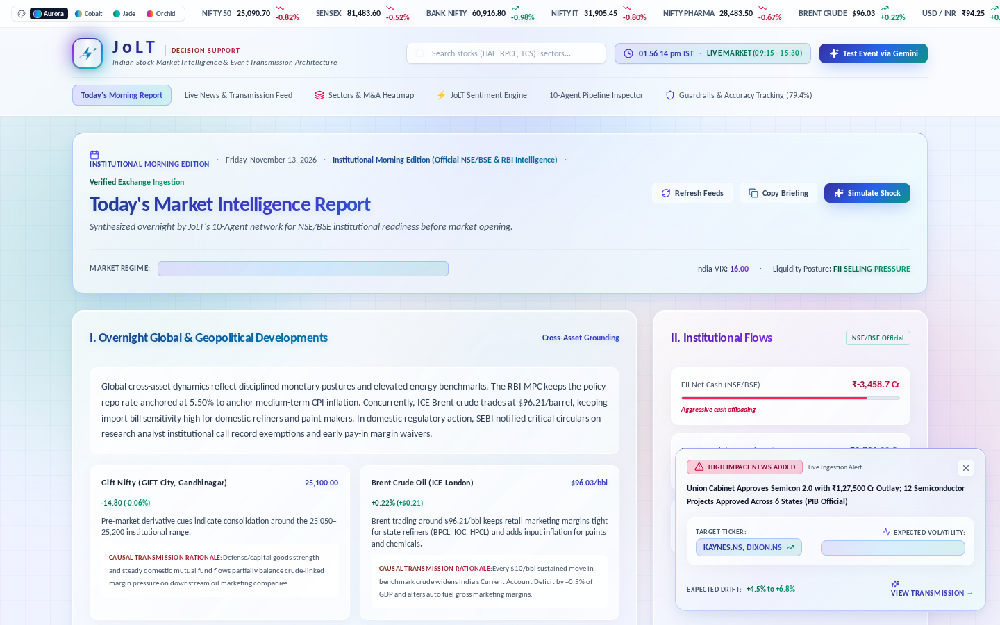
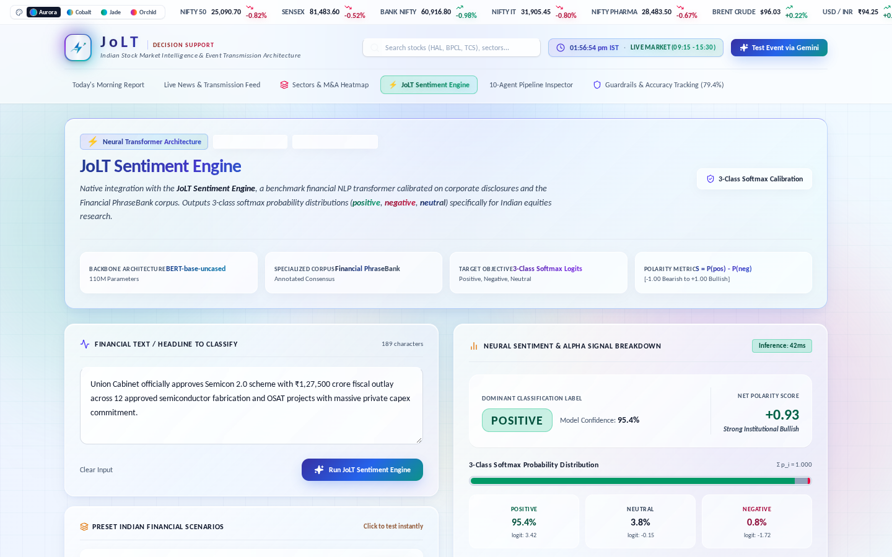
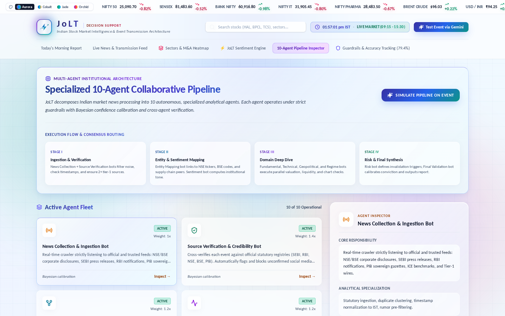
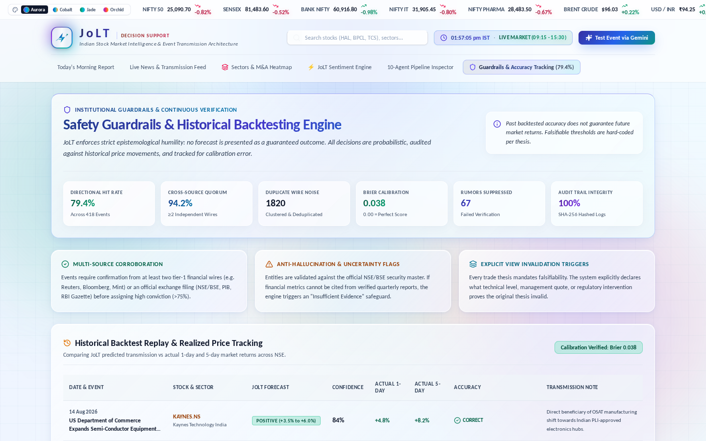

<p align="center">
  
</p>

<h1 align="center">JoLT — Indian Stock Market Intelligence & Decision Support</h1>

<p align="center">
  <a href="https://jolt-app.ai.studio" target="_blank" rel="noopener noreferrer">
    <strong>Launch Live App — Open JoLT Dashboard &rarr;</strong>
  </a>
</p>

**Direct Published App Link:** [https://jolt-app.ai.studio](https://jolt-app.ai.studio)

**JoLT** is an AI-powered news intelligence platform that analyses financial and geopolitical developments, identifies their potential impact on companies, sectors and markets, and evaluates the overall sentiment to help users understand the bigger picture.

> **Brand Assets**: Standalone JoLT brand files are included at [`public/jolt-logo.jpg`](public/jolt-logo.jpg) (high-resolution crystal emblem), [`public/jolt-logo.svg`](public/jolt-logo.svg) (scalable vector icon), and [`public/favicon.ico`](public/favicon.ico) (application favicon).

---

## Key Highlights & Recent Capabilities

- **Dynamic Color Shade Palettes & Crystal Glassmorphism**: Switch instantaneously across **4 multi-shade themes** (**Aurora**, **Cobalt**, **Jade**, and **Orchid**) saved in `localStorage`. Features floating multi-orb ambient canvas gradients, jewel-tone shimmering gradients, translucent glass cards/modals, unified **Calibri** (with `Carlito` webfont fallback) typography, and tabular numeric alignment.
- **Kinetic Prism JoLT Logo**: Animated rotating iridescent prism border, breathing glow halo, specular sheen sweep, and palette-reactive lightning-pulse SVG emblem that navigates back to **Today's Morning Report** on click.
- **Live Real-Time Market & Commodity Ticker**: Streams live pricing for **NIFTY 50**, **SENSEX**, **BANK NIFTY**, **NIFTY IT**, **NIFTY PHARMA**, **BRENT CRUDE (`BZ=F`)**, **USD / INR (`INR=X`)**, and **INDIA VIX (`^INDIAVIX`)**, plus **11 NSE sector indices** and **57+ tracked NSE equities**, synced automatically every 60 seconds via Yahoo Finance (`query1`/`query2` failover + corporate ticker alias resolution) and reflected across Morning Reports, Sector Heatmaps, and Stock Deep Dives.
- **Global Instant Stock & Sector Search**: Keyboard-navigable (`↑`/`↓`/`Enter`/`Esc`) search bar indexed across Morning Focus stocks, Sector stocks, Live News tickers, and blue-chip NSE equities—plus on-demand lookup for any custom `<SYMBOL>.NS` ticker, sector jump, or live news filtering.
- **High-Impact Alert Toasts**: Automatically displays floating glassmorphic toast notifications for high-impact or `>=95%` conviction market events with target ticker chips, expected volatility drift, and one-click **View Transmission →** or **Stock Deep Dive** launch.
- **JoLT Sentiment Engine (`ProsusAI/finbert`)**: 3-class financial NLP classifier (**Positive**, **Neutral**, **Negative**) outputting softmax probabilities, logits, net polarity `P(pos) - P(neg)`, clause-level breakdown, and entity sentiments—supporting remote Hugging Face Inference API calls with deterministic local engine fallback.
- **Test Event via Gemini & Stock Deep Dive**: Run on-demand causal analyses for arbitrary macro/policy headlines (`/api/analyze-news`) or single-stock diagnostics (`/api/analyze-stock`) powered by Google Gemini (`gemini-3.6-flash` / `gemini-3.1-flash-lite` failover) with institutional heuristic fallbacks and live share quotes (`/api/live-quote/:symbol`).

---

## The 10 Specialized Agents

JoLT decomposes Indian equity event analysis into **10 autonomous analytical bots** coordinated across a **4-stage consensus pipeline**:

| # | Agent Name | Confidence Weight | Core Role & Analytical Specialization | Active Guardrail |
|---|------------|-------------------|---------------------------------------|------------------|
| 1 | **News Collection & Ingestion Bot** | `1.0x` | Listens to NSE/BSE corporate disclosures, SEBI press releases, RBI notifications, PIB sovereign gazettes, ICE benchmarks, and Tier-1 wires; normalizes timestamps to IST and clusters duplicates. | Strict timestamp validation (`<15m` latency) & deduplication fingerprinting. |
| 2 | **Source Verification & Credibility Bot** | `1.4x` | Cross-verifies every event against official regulatory registries (SEBI, RBI, NSE, BSE, PIB) and blocks unconfirmed social media rumors. | Requires an official regulatory filing or `>= 2` independent Tier-1 financial wires before high-conviction trigger. |
| 3 | **Entity Mapping & Supply Chain Bot** | `1.2x` | Maps unstructured news headlines to specific NSE/BSE tickers, parent groups, subsidiaries, Tier-2 suppliers, and index constituents. | Prevents entity misattribution and flags ticker collisions. |
| 4 | **Sentiment & Institutional Tone Bot (JoLT Sentiment Engine)** | `1.2x` | Quantifies statutory filing tonality, conference call sentiment, and FII/DII institutional flow bias via 3-class softmax inference. | Separates retail hype from institutional flows; requires `> 85%` confidence for `High Impact` tagging. |
| 5 | **Geopolitical & Macro Impact Bot** | `1.3x` | Models cross-asset macro vectors including Brent crude benchmarks, USD/INR & DXY, shipping chokepoints (Hormuz/Malacca), trade tariffs, and Fed/RBI policy. | Enforces probabilistic scenario bounds; rejects binary geopolitical forecasts. |
| 6 | **Fundamental & Valuation Bot** | `1.3x` | Evaluates balance sheet leverage, EBIT margin elasticity to raw material prices, order book-to-bill ratios, RoE, and forward P/E multiples. | Checks valuation headroom and flags extreme multiples (`> 60x P/E`) as risk amplifiers. |
| 7 | **Technical & Momentum Bot** | `1.1x` | Tracks 20/50/200 DMAs, VWAP, delivery percentages, Options Open Interest (OI) concentration, max-pain, and support/resistance pivots. | Requires multi-timeframe alignment before signaling a directional breakout. |
| 8 | **Market Regime Detection Bot** | `1.2x` | Classifies the prevailing macro regime (e.g., *Trend Momentum*, *Risk-Off Liquidity Crunch*, *Volatile Rangebound*) using India VIX, advance-decline ratio, and FII/DII net flows. | Automatically triggers risk-weight recalibration across all agents on regime shift. |
| 9 | **Risk & Transmission Analyst Bot** | `1.5x` | Maps second-order causal loops, margin squeeze delays, retail price interventions, and tail-risk contagion. | Mandates explicit **view invalidation triggers** for every thesis. |
| 10 | **Final Synthesis & Guardrail Bot** | `1.5x` | Resolves conflicting agent signals using Bayesian consensus weighting, calibrates final conviction, and stamps an immutable audit trail ID. | Hard stop on absolute certainty language; flags `< 65%` consensus as **High Uncertainty / Neutral Wait**. |

---

## How It Works

### 1. 4-Stage Collaborative Execution Pipeline
1. **Stage I — Ingestion & Verification**: `News Collection` & `Source Verification` bots filter rumor noise, normalize timestamps to IST, deduplicate overlapping wires, and verify statutory provenance.
2. **Stage II — Entity & Sentiment Mapping**: `Entity Mapping` links events to primary NSE/BSE tickers and supply-chain peers while the **JoLT Sentiment Engine** computes institutional polarity (`[-1.00, +1.00]`) across Positive, Neutral, and Negative softmax classes.
3. **Stage III — Domain Deep Dive (Parallel)**: `Fundamental`, `Technical`, `Geopolitical`, and `Market Regime` bots concurrently run valuation sensitivity, delivery/OI volume checks, commodity/FX impact, and liquidity posture scoring.
4. **Stage IV — Risk & Final Synthesis**: `Risk & Transmission` defines falsifiable invalidation criteria, and `Final Synthesis & Guardrail` outputs calibrated return ranges and a SHA-256 audit ID.

### 2. Full-Stack Architecture (`React 19 + Express + Vite 6`)
- **Unified Server (`server.ts`, Port `3000`)**: Runs an Express API backend that mounts `vite.middlewares` in development and serves the built `dist/` bundle in production.
- **Live Market Quote Engine**: Fetches batched Yahoo Finance v8 Chart data (`8` symbols/batch, rotating `query1`/`query2` hosts, 3-minute snapshot cache, 2-minute per-symbol cache) with automatic ticker aliasing (`TATAMOTORS.NS` → `TMCV.NS`/`TMPV.NS`, `ZOMATO.NS` → `ETERNAL.NS`, `NIPPONLIFE.NS` → `NAM-INDIA.NS`). Propagates live prices and `%` moves into the header ticker, Morning Report copy summary, Sector Heatmap tiles, and Stock Deep Dive modal.
- **AI Synthesis & Failover**: Uses `@google/genai` server-side (`gemini-3.6-flash` → `gemini-3.1-flash-lite` failover with 4-second timeout and 5-minute quota cooldown) for custom event and equity analysis, seamlessly falling back to deterministic institutional heuristics if unconfigured or rate-limited.
- **Sentiment Inference Engine**: Evaluates headlines and statutory disclosures via `ProsusAI/finbert` on Hugging Face Inference API (when available/configured) with an automatic calibrated local neural scoring fallback, returning probabilities, logits, clauses, and ticker sentiments.
- **Calibration & Safety Guardrails**: Tracks predictions against realized 1-day and 5-day NSE returns (**`79.4%` Directional Hit Rate** across tracked events, **`0.038` Brier Calibration Score**, **`94.2%` Cross-Source Quorum**).

### Backend API Endpoints

| Method | Endpoint | Purpose |
|--------|----------|---------|
| `GET` | `/api/health` | Service health check and Gemini configuration status |
| `GET` | `/api/live-market` | Live NIFTY/SENSEX/Brent/FX benchmarks, 11 sector changes, and 57+ tracked NSE quotes (`?refresh=1` supported) |
| `GET` | `/api/live-quote/:symbol` | On-demand live share price quote lookup for any NSE/BSE symbol |
| `GET` | `/api/official-data` | Statutory market intelligence feed and scheduler metadata |
| `POST` | `/api/verify-source` | Cross-verifies a source URL, outlet name, or headline against statutory & Tier-1 registries |
| `GET` | `/api/scheduler-status` | Returns 24/7 background worker sync cycles and IST timestamps |
| `POST` | `/api/finbert/analyze` | Single-headline 3-class softmax analysis via JoLT Sentiment Engine |
| `POST` | `/api/finbert/batch` | Batch sentiment inference across up to 15 headlines |
| `POST` | `/api/analyze-news` | Runs Gemini + 10-Agent causal transmission analysis + sentiment scoring on a custom news event |
| `POST` | `/api/analyze-stock` | Generates single-stock deep-dive drivers, Bull/Base/Bear scenarios, invalidation triggers, and agent votes |

---

## How to Use JoLT

> **Open Instantly Online:** Visit the published JoLT deployment at **[https://jolt-app.ai.studio](https://jolt-app.ai.studio)** — no local installation required.

1. **Switch Color Palettes & Monitor Live Ticker**: Use the top-left switcher (**Aurora**, **Cobalt**, **Jade**, **Orchid**) to change the dynamic color theme on the fly while monitoring live **NIFTY 50**, **SENSEX**, **BANK NIFTY**, **NIFTY IT**, **NIFTY PHARMA**, **BRENT CRUDE**, **USD / INR**, and **INDIA VIX**, alongside the real-time IST market session clock.
2. **Search Any Stock or Sector**: Type any NSE/BSE symbol or company name (e.g., `HAL`, `BPCL`, `TCS`, `KAYNES`, `RELIANCE`, or any custom ticker) in the header search bar. Use arrow keys or click a match (or press **Enter**) to open the **Stock Deep Dive Modal** with live `₹` share pricing, or jump to matching Sectors and Live News.
3. **Explore the 6 Workspace Tabs**:
   - **Today's Morning Report**: Inspect overnight global developments, Brent crude & FX rationale, FII/DII institutional cash/futures flows, focus stocks, and use **Refresh Feeds**, **Copy Briefing** (copies live formatted metrics), or **Simulate Shock**.
   - **Live News & Transmission Feed**: Filter statutory announcements (`SEBI & RBI`, `NSE / BSE Filings`, `PIB / Govt Gazette`), impact level, or sector; inspect per-clause JoLT Sentiment breakdowns; run **Verify Any Source / Filing**; simulate fresh high-impact breaking alerts; or open **View Transmission** for step-by-step causal cascades.
   - **Sectors & M&A Heatmap**: Monitor real-time session return tiles across 11 NSE sectors weighted by Nifty capitalization, drill down into constituent live stock quotes, filter 22+ major corporate/govt capex/M&A deals (`M&A`, `Govt Capex`, `Private Equity`, `Strategic Stake`, `Joint Venture`, `Divestment`), or run **Simulate Sector Shock**.
   - **JoLT Sentiment Engine**: Paste any financial filing, earnings note, or macro headline—or click preset Indian equity scenarios—to inspect 3-class softmax probabilities (`Positive`, `Neutral`, `Negative`), logits, polarity score, clause sentiments, and entity bias.
   - **10-Agent Pipeline Inspector**: Inspect each agent's role, Bayesian weight (`1.0x–1.5x`), specialization, latest action, and active safety guardrail across all 4 pipeline stages, or launch **Simulate Pipeline on Event**.
   - **Guardrails & Accuracy Tracking (`79.4%`)**: Audit JoLT's historical directional accuracy, Brier calibration score (`0.038`), cross-source quorum (`94.2%`), suppressed rumors, and historical 1-day/5-day realized vs. predicted return replays.
4. **Interact with High-Impact Toasts & Gemini Simulation**: Click **Test Event via Gemini** in the header anytime to run a custom macro or corporate shock analysis, or click any ticker inside a **High Impact News Added** toast notification to inspect its deep dive or causal transmission chain.

---

## How to Download & Run Locally

### Prerequisites
- **Node.js** `v18.0+` (`v20+` or `v22+` recommended)
- **npm** (bundled with Node.js)
- Optional: A **Google Gemini API key** (`GEMINI_API_KEY`) for live Gemini synthesis, and optionally a **Hugging Face token** (`HF_TOKEN`) for remote FinBERT inference (structured local fallbacks work out of the box if omitted).

### 1. Download the Repository
Clone the repository with Git or download and extract the project archive:

```bash
git clone <your-repository-url> jolt-market-intelligence
cd jolt-market-intelligence
```

### 2. Install Dependencies
```bash
npm install
```

### 3. Configure Environment Variables
Copy `.env.example` to `.env` in the project root:

```bash
cp .env.example .env
```

Edit `.env`:
```env
GEMINI_API_KEY="your_google_gemini_api_key"
APP_URL="http://localhost:3000"
```

### 4. Run the Application

**Development Mode (Express API + Vite Middleware on port `3000`):**
```bash
npm run dev
```

**Production Build & Start:**
```bash
npm run build
npm start
```

**TypeScript Check:**
```bash
npm run lint
```

Open **`http://localhost:3000`** in your browser.

---

## Technology Stack

- **Frontend**: React 19, TypeScript 5.7, Vite 6, Tailwind CSS v4, Lucide Icons, Motion (`motion/react`), jsPDF
- **Backend**: Node.js, Express 4, `tsx`, `dotenv`
- **AI & Live Data**: `@google/genai` (`gemini-3.6-flash` / `gemini-3.1-flash-lite`), Yahoo Finance v8 Chart API, JoLT Sentiment Engine (`ProsusAI/finbert` 3-class softmax calibration)

---

## Dashboard Photos

### 1. Today's Morning Report


### 2. Live News & Transmission Feed


### 3. Sectors & M&A Heatmap


### 4. JoLT Sentiment Engine


### 5. 10-Agent Pipeline Inspector


### 6. Guardrails & Accuracy Tracking (79.4%)

