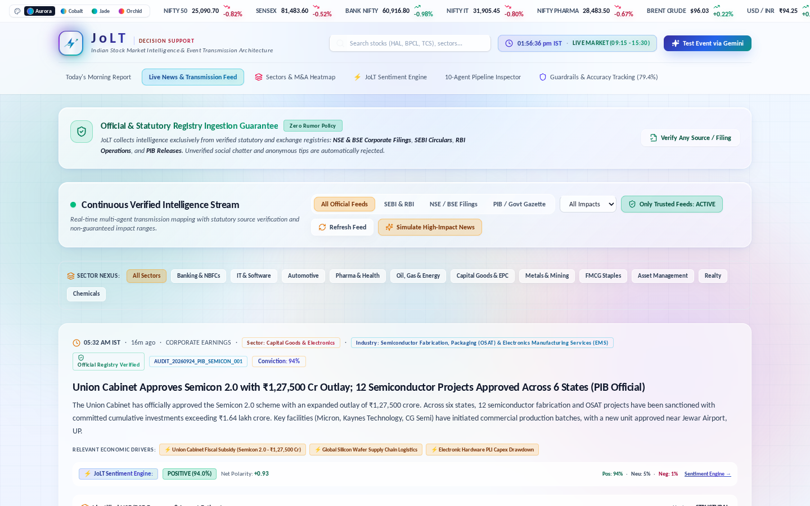
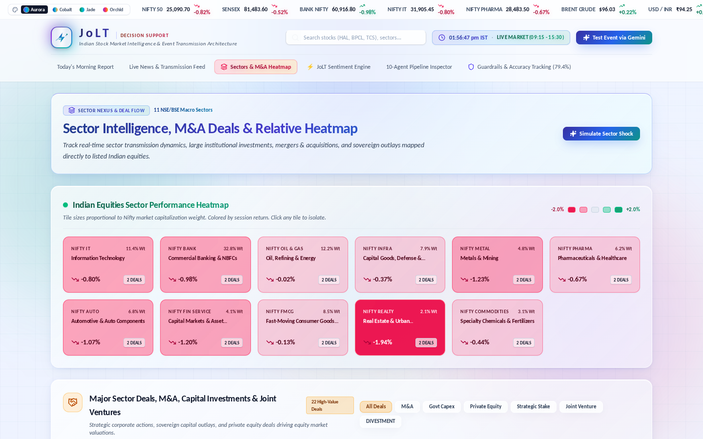

<p align="center">
  
</p>

<h1 align="center">JoLT — Indian Stock Market Intelligence & Decision Support</h1>

<p align="center">
  <a href="https://jolt-app.ai.studio" target="_blank" rel="noopener noreferrer">
    <strong>Launch Live App — Open JoLT Dashboard &rarr;</strong>
  </a>
</p>

**Direct Published App Link:** [https://jolt-app.ai.studio](https://jolt-app.ai.studio)

**JoLT** is a full-stack Indian equity market intelligence and causal transmission platform built for NSE and BSE research. It continuously ingests statutory filings, global macro shifts, commodity benchmarks, and sector deal flows, synthesizes them through a **10-Agent Collaborative Pipeline**, scores institutional polarity via the **JoLT Sentiment Engine**, and presents actionable, falsifiable decision support before and during live market hours (`09:15 – 15:30 IST`).

> **Brand Assets**: Standalone JoLT brand files are included at [`public/jolt-logo.jpg`](public/jolt-logo.jpg) (high-resolution crystal emblem), [`public/jolt-logo.svg`](public/jolt-logo.svg) (scalable vector icon), and [`public/favicon.ico`](public/favicon.ico) (application favicon).

---

## Key Highlights

- **Real-Time Market Benchmark Ticker**: Live streaming prices for **NIFTY 50**, **SENSEX**, **BANK NIFTY**, **NIFTY IT**, **NIFTY PHARMA**, **BRENT CRUDE**, **USD / INR**, and **INDIA VIX** fetched dynamically via backend Yahoo Finance quote batching (`query1`/`query2` failover with 3-minute snapshot caching) alongside live NSE/BSE equity quotes.
- **Crystal Glassmorphic Design & Dynamic Color Palettes**: Transparent layered glassmorphism styled in **Calibri**, anchored by an animated crystal-prism **JoLT** brand emblem and **4 instant color shade palettes** (**Aurora**, **Cobalt**, **Jade**, **Orchid**) persisted in `localStorage`.
- **10-Agent Decision Architecture**: Decomposes market intelligence across 4 execution stages with weighted Bayesian consensus voting (`1.0x` to `1.5x` confidence weights), mandatory invalidation triggers, and anti-hallucination guardrails.
- **JoLT Sentiment Engine**: Financial NLP classifier built around a BERT-base-uncased / Financial PhraseBank 3-class softmax framework (**Positive**, **Neutral**, **Negative**) outputting logits, confidence percentages, and net polarity scores `P(pos) - P(neg)`.
- **Global Instant Stock & Sector Search**: Search any cataloged or custom NSE/BSE ticker (e.g., `HAL`, `BPCL`, `TCS`, `RELIANCE`, `KAYNES`), jump straight to **Stock Deep Dive** diagnostics, or filter sector M&A flows and live news.
- **Custom Event Simulation via Gemini**: Test custom headlines, RBI/SEBI policy changes, or geopolitical shocks on demand using Google Gemini (`gemini-3.6-flash` / `gemini-3.1-flash-lite` failover) with automatic structured fallback if API quota is exhausted or unconfigured.

---

## The 10 Specialized Agents

JoLT splits equity event analysis into **10 autonomous analytical bots** coordinated across a **4-stage consensus pipeline**:

| # | Agent Name | Confidence Weight | Core Role & Analytical Specialization | Active Guardrail |
|---|------------|-------------------|---------------------------------------|------------------|
| 1 | **News Collection & Ingestion Bot** | `1.0x` | Listens to NSE/BSE corporate disclosures, SEBI press releases, RBI notifications, PIB sovereign gazettes, ICE benchmarks, and Tier-1 wires; normalizes timestamps to IST and clusters duplicates. | Strict timestamp validation (`<15m` latency) & deduplication fingerprinting. |
| 2 | **Source Verification & Credibility Bot** | `1.4x` | Cross-verifies every event against official regulatory registries (SEBI, RBI, NSE, BSE, PIB) and blocks unconfirmed social media rumors. | Requires an official regulatory filing or `>= 2` independent Tier-1 financial wires before high-conviction trigger. |
| 3 | **Entity Mapping & Supply Chain Bot** | `1.2x` | Maps unstructured news headlines to specific NSE/BSE tickers, parent groups, subsidiaries, Tier-2 suppliers, and index constituents. | Prevents entity misattribution and flags ticker collisions. |
| 4 | **Sentiment & Institutional Tone Bot (JoLT Sentiment Engine)** | `1.2x` | Quantifies statutory filing tonality, conference call sentiment, and FII/DII institutional flow bias via 3-class softmax inference. | Separates retail hype from institutional flows; requires `> 85%` confidence for `High Impact` tagging. |
| 5 | **Geopolitical & Macro Impact Bot** | `1.3x` | Models cross-asset macro vectors including Brent crude benchmarks, USD/INR & DXY, shipping chokepoints (Hormuz/Malacca), trade tariffs, and Fed/RBI policy. | Enforces probabilistic scenario bounds; rejects binary geopolitical forecasts. |
| 6 | **Fundamental & Valuation Bot** | `1.3x` | Evaluates balance sheet leverage, EBIT margin elasticity to raw material prices, order book-to-bill ratios, RoE, and forward P/E multiples. | Checks valuation headroom and flags extreme multiples (`> 60x P/E`) as risk amplifiers. |
| 7 | **Technical & Momentum Bot** | `1.1x` | Tracks 20/50/200 DMAs, VWAP, delivery percentages, Options Open Interest (OI) concentration, max-pain, and support/resistance pivots. | Requires multi-timeframe alignment before signaling a directional breakout. |
| 8 | **Market Regime Detection Bot** | `1.2x` | Classifies the prevailing macro regime (e.g., *Trend Momentum*, *Risk-Off Liquidity Crunch*, *Volatile Rangebound*) using India VIX, advance-decline ratio, and FII/DII net flows. | Automatically triggers risk-weight recalibration across all agents on regime shift. |
| 9 | **Risk & Transmission Analyst Bot** | `1.5x` | Maps second-order causal loops, margin squeeze delays, retail price interventions, and tail-risk contagion. | Mandates explicit **view invalidation triggers** for every thesis. |
| 10 | **Final Synthesis & Guardrail Bot** | `1.5x` | Resolves conflicting agent signals using Bayesian consensus weighting, calibrates final conviction, and stamps an immutable audit trail ID. | Hard stop on absolute certainty language; flags `< 65%` consensus as **High Uncertainty / Neutral Wait**. |

---

## How It Works

### 1. 4-Stage Collaborative Execution Pipeline
1. **Stage I — Ingestion & Verification**: `News Collection` & `Source Verification` bots filter rumor noise, normalize timestamps to IST, deduplicate overlapping wires, and verify statutory provenance.
2. **Stage II — Entity & Sentiment Mapping**: `Entity Mapping` links events to primary NSE/BSE tickers and supply-chain peers while the **JoLT Sentiment Engine** computes institutional polarity (`[-1.00, +1.00]`) across Positive, Neutral, and Negative softmax classes.
3. **Stage III — Domain Deep Dive (Parallel)**: `Fundamental`, `Technical`, `Geopolitical`, and `Market Regime` bots concurrently run valuation sensitivity, delivery/OI volume checks, commodity FX impact, and liquidity posture scoring.
4. **Stage IV — Risk & Final Synthesis**: `Risk & Transmission` defines falsifiable invalidation criteria, and `Final Synthesis & Guardrail` outputs calibrated return ranges and a SHA-256 audit ID.

### 2. Full-Stack Architecture (`React 19 + Express + Vite 6`)
- **Single-Port Server (`server.ts`, Port `3000`)**: Runs an Express backend that serves `/api/*` routes and mounts `vite.middlewares` during development (or static bundle assets in production).
- **Live Market Data Layer**: Fetches live quotes asynchronously in throttled batches (`8` symbols/batch) with host rotation (`query1.finance.yahoo.com` / `query2.finance.yahoo.com`), ticker aliasing (e.g., `TATAMOTORS.NS` / `TMCV.NS`, `ZOMATO.NS` / `ETERNAL.NS`), 2-minute per-symbol caching, and automatic live price propagation into indices, sector tiles, and stock deep-dive cards.
- **Gemini AI Event & Equity Engine**: Uses `@google/genai` server-side with automatic failover between `gemini-3.6-flash` and `gemini-3.1-flash-lite` (4s timeout + 5-minute quota cooldown protection) to analyze arbitrary user-submitted market events (`/api/analyze-news`) and generate structured stock deep-dive briefings (`/api/analyze-stock`).
- **Calibration & Safety Guardrails**: Tracks historical predictions against realized 1-day and 5-day NSE returns (**`79.4%` Directional Hit Rate** across tracked events, **`0.038` Brier Calibration Score**, **`94.2%` Cross-Source Quorum**).

### Backend API Endpoints

| Method | Endpoint | Purpose |
|--------|----------|---------|
| `GET` | `/api/health` | Service health check and Gemini configuration status |
| `GET` | `/api/live-market` | Live NIFTY/SENSEX/commodity benchmarks, sector changes, and tracked NSE quotes (`?refresh=true` supported) |
| `GET` | `/api/live-quote/:symbol` | On-demand live quote lookup for any NSE/BSE symbol |
| `GET` | `/api/official-data` | Statutory market intelligence feed and scheduler metadata |
| `POST` | `/api/verify-source` | Cross-verifies a source URL or news snippet against statutory registry patterns |
| `GET` | `/api/scheduler-status` | Returns ingestion worker timings and live market phase status |
| `POST` | `/api/finbert/analyze` | Single-headline 3-class softmax analysis via JoLT Sentiment Engine |
| `POST` | `/api/finbert/batch` | Batch sentiment inference across multiple headlines |
| `POST` | `/api/analyze-news` | Runs Gemini + 10-Agent causal transmission analysis on a custom news event |
| `POST` | `/api/analyze-stock` | Generates deep-dive causal, technical, fundamental, and invalidation diagnostics for a ticker |

---

## How to Use JoLT

> **Open Instantly Online:** Visit the published JoLT deployment at **[https://jolt-app.ai.studio](https://jolt-app.ai.studio)** — no local installation required.

1. **Switch Color Palettes & Monitor Live Ticker**: Use the top-left switcher (**Aurora**, **Cobalt**, **Jade**, **Orchid**) to change the dynamic glassmorphism theme on the fly, while the top ticker bar streams live **NIFTY 50**, **SENSEX**, **BANK NIFTY**, **NIFTY IT**, **NIFTY PHARMA**, **BRENT CRUDE**, **USD / INR**, and **INDIA VIX**.
2. **Search Any Stock or Sector**: Type a symbol or company name (such as `HAL`, `BPCL`, `TCS`, `KAYNES`, or any custom `.NS` symbol) in the header search bar. Press **Enter** or click a result to open the **Stock Deep Dive Modal**, or jump directly to matching sectors and news items.
3. **Navigate the 6 Core Workspace Tabs**:
   - **Today's Morning Report**: Review overnight global & geopolitical developments, institutional FII/DII flows, top stocks requiring attention, and trigger **Refresh Feeds**, **Copy Briefing**, or **Simulate Shock**.
   - **Live News & Transmission Feed**: Filter statutory filings by source (`SEBI & RBI`, `NSE / BSE Filings`, `PIB / Govt Gazette`), impact level, or sector, inspect causal drivers, verify external sources, or click **View Transmission** to open the causal chain modal.
   - **Sectors & M&A Heatmap**: Inspect relative session performance across 11 NSE sector indices sized by Nifty weight, filter 22+ high-value deals (`M&A`, `Govt Capex`, `Private Equity`, `Strategic Stake`, `Joint Venture`, `Divestment`), or run a **Sector Shock** simulation.
   - **JoLT Sentiment Engine**: Paste any corporate filing, RBI note, or financial headline—or click preset Indian equity scenarios—to inspect real-time 3-class softmax probabilities (`Positive`, `Neutral`, `Negative`), logits, and net polarity scores.
   - **10-Agent Pipeline Inspector**: Inspect each agent's role, confidence weight (`1.0x–1.5x`), latest execution log, and active guardrail across the 4-stage pipeline, or click **Simulate Pipeline on Event**.
   - **Guardrails & Accuracy Tracking (`79.4%`)**: Audit JoLT's historical directional accuracy, Brier calibration metrics (`0.038`), suppressed rumors, and 1-day/5-day realized vs. predicted return replays.
4. **Test Custom Scenarios**: Click **Test Event via Gemini** in the header at any time to inject a hypothetical macro, regulatory, or corporate shock and watch JoLT map affected NSE/BSE winners, losers, transmission mechanics, and invalidation triggers.

---

## How to Download & Run Locally

### Prerequisites
- **Node.js** `v18.0+` (recommended `v20+` or `v22+`)
- **npm** (bundled with Node.js)
- Optional: A **Google Gemini API key** (`GEMINI_API_KEY`) for live AI event & equity synthesis (the app includes a structured deterministic fallback if `GEMINI_API_KEY` is omitted).

### 1. Download the Repository
Clone the project with Git or download and extract the ZIP archive from your repository host:

```bash
git clone <your-repository-url> jolt-market-intelligence
cd jolt-market-intelligence
```

### 2. Install Dependencies
```bash
npm install
```

### 3. Configure Environment Variables
Copy `.env.example` to `.env` in the project root and add your values:

```bash
cp .env.example .env
```

Edit `.env`:
```env
GEMINI_API_KEY="your_google_gemini_api_key"
APP_URL="http://localhost:3000"
```

### 4. Run the Application

**Development Mode (Express API + Vite HMR/Middleware on port `3000`):**
```bash
npm run dev
```

**Production Build & Start:**
```bash
npm run build
npm start
```

**Type Check:**
```bash
npm run lint
```

Once running, open **`http://localhost:3000`** in your browser.

---

## Technology Stack

- **Frontend**: React 19, TypeScript 5.7, Vite 6, Tailwind CSS v4, Lucide Icons, Motion (`motion/react`), jsPDF
- **Backend**: Node.js, Express 4, `tsx`, `dotenv`
- **AI & Data**: `@google/genai` (`gemini-3.6-flash` / `gemini-3.1-flash-lite`), Yahoo Finance v8 Chart API, JoLT Sentiment Engine (`Financial PhraseBank` 3-class calibration)

---

## Dashboard Photos

### 1. Today's Morning Report


### 2. Live News & Transmission Feed


### 3. Sectors & M&A Heatmap


### 4. JoLT Sentiment Engine


### 5. 10-Agent Pipeline Inspector


### 6. Guardrails & Accuracy Tracking (79.4%)

